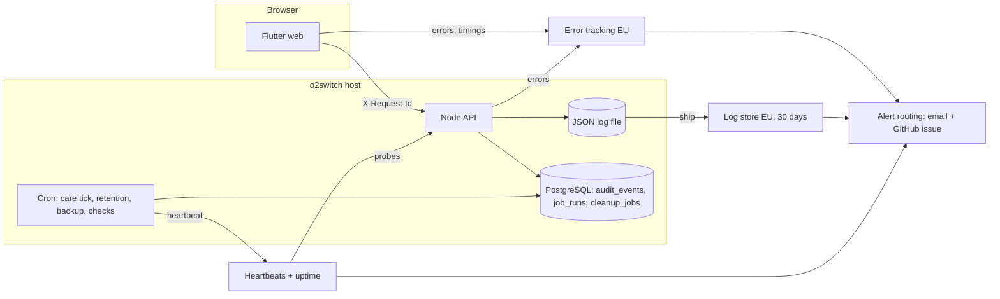

# Logging and monitoring — review and implementation plan

A first review of what Agatha Track logs and monitors today, and a phased plan to close the gaps.
Current behaviour stays documented in [observability.md](./observability.md); this file is the proposal.
As each step ships, its content moves into `observability.md` (or the runbook it names) and the step is
ticked here. When every step is done, delete this file.

**How to resume:** find the first step not marked ✅ in the [status board](#status-board) and tell the
agent: *"Let's do step N of `docs/ops/observability-review-and-plan.md`."*

Figures below were measured on `main` at `2a5f3ac` (2026-11-10), runtime code only (tests excluded).

## Summary

More exists than "very little", but almost none of it can be seen or acted on.

- **In place:** a Pino JSON logger, a request ID and access log line on every API call, an `audit_events`
  table with tiered retention, consent-gated PostHog analytics, a durable `cleanup_jobs` queue, a post-deploy
  smoke, a nightly UAT in-host smoke, and weekly CodeQL, ZAP, k6 and `npm audit` runs.
- **The main gap is that nobody is told when something breaks.** Logs go to the cPanel/Passenger error log on
  the host and nowhere else. There is no log search, no error grouping, no uptime check, no alert and no
  on-call route. Every "alert" in the existing docs is a log line that someone would have to go and read.
- **The most serious code finding:** 192 `catch` blocks across 48 route files answer `500` and log nothing.
  The access log records that a 500 happened, but the error and stack trace are discarded. These failures
  cannot be diagnosed today.
- **The browser app reports nothing.** Flutter has no global error handler; 97 of 233 `catch` blocks are
  silent. A crash in a user's browser is invisible.

## Constraints that shape the plan

| Constraint | Effect |
|------------|--------|
| o2switch shared cPanel, Passenger, local PostgreSQL | No agents, sidecars or collectors on the host. No host CPU, memory or disk metrics beyond what cPanel shows. Everything must be in-process, cron, or an outside service called over HTTPS. |
| One Node process serves the API and the Flutter web build | Process-level signals (event-loop lag, memory, pool use) stand in for infrastructure metrics. |
| Health data, GDPR, EU hosting | Any new vendor is a new processor: EU region, DPA, and an entry in `regulatory/INTERNAL_GDPR.md` and the privacy notice. Logs must never carry health content, tokens or contact details. |
| Analytics is consent-based | PostHog cannot be the only source for errors or operational health: it only sees consenting users. |
| Pre-launch, production has no users | Thresholds can be set loosely and tuned on UAT first. Schema and log-format changes are cheap now and costly later. |
| CI minutes and a small team | Few vendors, few dashboards. Prefer alerts that create a GitHub issue or an email over a console someone must watch. |

## Review by area

Rating: 🔴 missing · 🟠 partial, not usable in an incident · 🟡 works, with gaps · 🟢 adequate.

| # | Area | Now | What exists | Main gaps |
|---|------|-----|-------------|-----------|
| 1 | Infrastructure | 🔴 | `/health` and `/backend/health` return a fixed `OK`; startup checks the PG date parser | Health check never touches the database. No uptime monitor (open debt row). No process metrics. No `pool.on('error')` handler, so a dropped idle DB connection can crash the process. No `unhandledRejection` / `uncaughtException` handler. |
| 2 | Application logging | 🟠 | Pino; access log with `requestId`, method, path, status, duration (`server/middleware/requestContext.js`) | Only 24 logger calls in runtime code, against 23 `console.*` calls. No user ID, route template or release in the access line. No redaction config. Client-supplied `X-Request-Id` is trusted unchecked. Startup and shutdown use `console`. Logs stay on the host: no search, no stated rotation (the GDPR register promises 30 days). |
| 3 | Error monitoring | 🔴 | Central error middleware logs errors that reach it (`server/lib/http/errorMiddleware.js`) | 192 silent `500` handlers in 48 route files bypass it. No grouping, no release tagging, no notification. Nothing from the client. |
| 4 | Performance (APM) | 🟠 | `durationMs` per request; weekly k6 smoke against localhost in CI | Path contains IDs, so latency cannot be grouped by endpoint. No slow-query logging, no `statement_timeout`, no pool wait time. k6 never runs against a deployed host. |
| 5 | Frontend (RUM) | 🔴 | PostHog screen views for consenting users | No `FlutterError.onError`, `PlatformDispatcher.onError` or guarded zone. No load time, no API failure rate as the user sees it. The `request_id` the API returns in error bodies is not shown to the user or support. |
| 6 | Security monitoring | 🟠 | Auth rate limits; `auth.login_failed` audited; a written taxonomy with thresholds ([security-event-taxonomy.md](../engineering/pet-care-hardening/security-event-taxonomy.md)) | The taxonomy's alert rules are not implemented anywhere. 71 `403` responses and all `429` responses leave no security event. Share-link and health-file reads are not recorded. E2E bypass use is a `console.warn`. |
| 7 | Audit logging | 🟡 | `audit_events` with hot/warm/cold tiers; 59 call sites, about 60 actions | Only 17 of 151 route files write audit events. None in sharing (invites, role change, access removal), households, people, care context or health issues. Action names are inconsistent (`pet.updated` next to `update`, `create`, `add_reminder`). Writes are fire-and-forget, so an audit row can be lost without trace. Two pseudonym schemes: `pseudonymizeActor()` uses HMAC-SHA-256, the retention job uses `md5(id ‖ salt)`; `observability.md` documents the second. The retention cron is not installed (open debt row). |
| 8 | Business processes | 🟠 | `cleanup_jobs` with leases, retries and a `dead` state; care tick prints a JSON summary | No heartbeat on any scheduled job (care tick, audit retention, cleanup drain, suggestion generation). A cron that stops is silent. Dead jobs are only a log line. No record of emails sent or failed. |
| 9 | Integrations | 🔴 | PostHog person-delete has typed outcomes and retries | SMTP failures go to `console.error` in 8 places and are otherwise swallowed. No success/failure counts per provider. RevenueCat (`purchases_flutter`) and PostHog ingestion are unobserved. No outbound timeout or latency logging. |
| 10 | Product analytics | 🟠 | Consent gate, sensitive-screen exclusion, EU region, 12 custom events | All 12 events are care-done or weight flows. Nothing for signup, first pet, sharing, invites or paywall. No written event catalogue, no funnels or retention definitions. |
| 11 | Data integrity | 🟠 | One-off scripts: `reconcileHouseholds.js`, `reconcilePeopleVets.js`, `care/repair_occurrences.js --dry-run`; startup PG date check | Nothing scheduled. No invariant list. No check for orphaned files, access rows without a pet, or duplicate occurrences. |
| 12 | Operational governance | 🟠 | Deploy workflows with smoke and gate scripts; draft [backup plan](./prod-backup-restore-plan.md) (all steps open); weekly dependency and CI KPI jobs | No backups running. No certificate, domain or disk-quota check. No release marker in logs. No alert catalogue, severity routing or incident runbook. |

### Findings to fix regardless of tooling

1. **Silent 500s** — 192 handlers of the form `catch (err) { res.status(500).json({ error: publicError(err) }) }`.
2. **Process safety** — no pool error handler, no unhandled-rejection handler.
3. **Shallow health check** — reports `OK` while the database is down.
4. **Audit pseudonym mismatch** — code and retention job disagree; decide one scheme before real data exists.
5. **`logger.warn({ event })` in `server/lib/audit.js`** logs the whole audit event, including the `req` object,
   when required fields are missing. Log the action and resource type only.
6. **Failed login audit** records no usable target (no user, no hashed identifier), so repeated failures against
   one account cannot be counted.

## Target design

Three paths, one correlation ID.

Rules for every step:

1. **One event, one name.** Each log line carries a stable `event` (for example `http.request`,
   `email.failed`, `job.dead`, `authz.denied`). Alerts match on `event`, never on message text.
2. **One ID across the stack.** `requestId` is on the access line, error report, audit row and the error the
   user sees.
3. **Audit is not logging.** `audit_events` answers "who did what" and follows the retention tiers. Logs answer
   "what went wrong" and live 30 days. Product analytics answers "what do people use" and needs consent.
   Keep the three apart.
4. **Deny by default on content.** IDs, counts and field names only. No bodies, no health text, no emails, no
   tokens. Enforced by Pino `redact` and a test, not by care.
5. **Every scheduled job reports in.** Silence is the alert.
6. **Every alert has an owner, a severity and a runbook line** in one catalogue.

## Decisions needed before step 4

Steps 1–3 need no vendor and can start now. These need the owner (new processors and cost):

| # | Decision | Recommendation |
|---|----------|----------------|
| Q1 | Error tracking for API and Flutter web | A hosted EU error tracker with Node and Flutter SDKs (Sentry EU region is the usual choice). Run it on legitimate interest with scrubbing and no session replay, so it covers all users, not only those who accepted analytics. Alternative: PostHog error tracking, which adds no vendor but only sees consenting users. |
| Q2 | Log store | A hosted EU log service fed by a Pino transport or a small cron shipper, 30-day retention to match the GDPR register. Fallback with no vendor: rotated files on the host plus the checks in step 9, accepting no search. |
| Q3 | Uptime and heartbeats | Already asked as D3 in the backup plan (healthchecks.io plus an uptime monitor). Take one decision for both plans; prefer a single service that does both. |
| Q4 | Where alerts go | Email to the owner plus an auto-opened GitHub issue with an `incident` label for P0/P1; weekly digest issue for P2/P3. No paging before launch. |
| Q5 | Legal basis and notice text for error and log processing | Legitimate interest (Art. 6(1)(f)); add the processors to `INTERNAL_GDPR.md`, `DATA_MAP.md` and both privacy notices in the same PR that turns each one on. |
| Q6 | Audit pseudonym scheme | HMAC-SHA-256 with a dedicated `AUDIT_PSEUDONYM_SALT` (no fallback to `JWT_SECRET` in production); change the retention job to match. |

## Status board

One PR per step. Each PR updates `observability.md` and ticks its row here.

| Step | Title | Areas | PR | Status |
|------|-------|-------|----|--------|
| 1 | Log every server error | 2, 3 | | ⬜ |
| 2 | Logger foundation: context, redaction, process safety | 1, 2 | | ⬜ |
| 3 | Real health checks and process metrics | 1, 4 | | ⬜ |
| 4 | Uptime, heartbeats and alert routing | 1, 8, 12 | | ⬜ |
| 5 | Log shipping and retention | 2 | | ⬜ |
| 6 | Error tracking: API | 3 | | ⬜ |
| 7 | Error tracking and RUM: Flutter web | 3, 5 | | ⬜ |
| 8 | Audit coverage and consistency | 7 | | ⬜ |
| 9 | Security events and detection rules | 6 | | ⬜ |
| 10 | Job runs, email and integration outcomes | 8, 9 | | ⬜ |
| 11 | Endpoint and query performance | 4 | | ⬜ |
| 12 | Data integrity checks | 11 | | ⬜ |
| 13 | Product analytics catalogue and funnels | 10 | | ⬜ |
| 14 | Governance: alert catalogue, runbooks, release and expiry checks | 12 | | ⬜ |

Legend: ⬜ not started · 🟡 in progress · ✅ done (link PR)

Order: 1–3 first (no dependencies). 4–7 after Q1–Q5. 8–9 before launch. 10–14 can run in parallel after 5.

## Steps

### Phase A — make failures visible in the code (no vendor)

**Step 1 — Log every server error**

- Add `sendServerError(req, res, err, publicMessage?)` in `server/lib/http/` that logs `{ event: 'http.error', err, requestId, route }` and answers `500` with `request_id`. This also closes the open `publicError` debt row.
- Replace the 192 silent handlers. Where a route already uses `asyncHandler`, drop the `try/catch` and let the error middleware handle it.
- ESLint rule for `server/routes/**`: no `res.status(500)` outside the helper. Add to the baseline so it cannot regress.
- **Done when:** a forced failure in any route produces one error log line with a stack and the same `request_id` the client received; lint blocks a new silent handler.

**Step 2 — Logger foundation**

- `logger.js`: base fields `service`, `env`, `release` (git SHA written at deploy); Pino `redact` for `authorization`, `cookie`, `password`, `token`, `code`, `email`, `*.body`; error serialiser.
- `requestContext.js`: `req.log` child logger; add `userId` once auth has run, the Express route template (`/pets/:id`), response size; level by status (`warn` for 4xx security statuses, `error` for 5xx). Accept an inbound `X-Request-Id` only if it matches a UUID pattern.
- Replace the 23 runtime `console.*` calls; ESLint `no-console` for `server/{bin,lib,routes,services,config,middleware}`.
- `createPool.js`: `pool.on('error')`. `start.js`: `unhandledRejection` and `uncaughtException` handlers that log `fatal` and exit cleanly; structured startup and shutdown lines.
- Fix finding 5. Write the event-name catalogue into `observability.md`.
- **Done when:** a test proves a request carrying a password and bearer token logs neither; killing the DB connection logs an error and the process survives.

**Step 3 — Health checks and process metrics**

- Keep `/health` as liveness. Add `/health/ready`: `SELECT 1` with a short timeout, latest migration, release SHA, cleanup-runner state. No secrets, no counts of user data.
- Log `process.stats` every minute: event-loop lag, RSS and heap, pool total/idle/waiting.
- Point the post-deploy smoke and UAT in-host smoke at `/health/ready`.
- **Done when:** stopping PostgreSQL turns `/health/ready` to `503` within the timeout.

### Phase B — get the signals off the host and to a person

**Step 4 — Uptime, heartbeats, alert routing** (needs Q3, Q4)

- External probe on `/backend/health/ready` for UAT and production, plus TLS-expiry and domain-expiry checks.
- Heartbeat wrapper script for cron jobs (start, success, fail); apply to the care tick, `audit-retention.js` and `run-cleanup-jobs.js`. Share the crontab mechanism with backup plan step 3 rather than building a second one.
- Alert route per Q4. Closes the uptime and retention-cron debt rows.
- **Done when:** stopping the UAT app and skipping one cron run each raise an alert.

**Step 5 — Log shipping and retention** (needs Q2, Q5)

- Write logs to a rotated file outside the deploy folder; ship to the chosen store; 30-day retention in both places.
- Saved searches: errors by route, by release, one request by ID.
- **Done when:** a UAT request can be found by its `request_id` within a minute, and nothing older than 30 days exists.

**Step 6 — Error tracking: API** (needs Q1, Q5)

- SDK in `start.js`, fed from `sendServerError`, the error middleware, process handlers and job failures. Tags: release, route, `requestId`. Scrub with the same deny-list as the logger; send no bodies.
- Release created by the deploy workflows. Alert on a new error group and on a regression after deploy.
- **Done when:** a deliberate UAT error appears grouped, with the right release, and notifies.

**Step 7 — Error tracking and RUM: Flutter web** (needs Q1, Q5)

- Global handlers in `main.dart` (`FlutterError.onError`, `PlatformDispatcher.instance.onError`, guarded zone). Upload source maps in the web build.
- HTTP client: send a generated `X-Request-Id`, record failures and latency by endpoint template, keep the returned `request_id`.
- Show a short reference code in the shared failed-load widgets so a user can quote it to support.
- Triage the 97 silent `catch` blocks: report, or comment why ignoring is correct.
- Timings: app start to first usable screen, route change duration.
- No session replay, no screen content, sensitive screens excluded as in `analytics_service.dart`.
- **Done when:** a thrown error in a UAT build shows a readable Dart stack linked to the API error by ID.

### Phase C — security, audit and workflows (before launch)

**Step 8 — Audit coverage and consistency** (needs Q6)

- One registry of actions (`domain.verb_past`), with a test that rejects unknown actions; rename the outliers.
- Cover the missing mutations, sharing first: invite create/accept/decline/revoke, role change, access removal, unfollow; then households, people, care context, health issues, vets.
- Record sensitive reads: health-file download, share-link open, data export (present), org member viewing a person.
- Write the audit row inside the transaction for account, permission, sharing and deletion actions; keep fire-and-forget for the rest, with an `audit.write_failed` event that alerts.
- Apply Q6. Add a target hash to `auth.login_failed`. A coverage test lists mutating routes with no audit call against an allow-list.
- Closes the "extend `audit_events`" debt row.
- **Done when:** the coverage test passes with an empty unexplained list.

**Step 9 — Security events and detection rules**

- Emit `authz.denied` (403), `auth.rejected` (401) and `ratelimit.hit` (429, via the limiter `handler`) with user, IP, route template and reason. Audit E2E-bypass use.
- Implement the taxonomy thresholds as one scheduled check (`server/scripts/ops/security-check.js`) reading `audit_events` and the log store: failed-login bursts per account and per IP, reset storms, export volume, permission grants, mass deletion. Output goes through the step 4 alert route.
- Move the taxonomy from `docs/engineering/pet-care-hardening/` to `docs/ops/` as the live rule list.
- **Done when:** scripted brute force on UAT raises a P1 within the documented window.

**Step 10 — Job runs, email and integration outcomes**

- `job_runs` table (job, started, finished, outcome, counts, redacted error) written by every scheduled script and the cleanup runner; `job.dead` and `job.failed` events alert.
- One mail path: every send goes through `sendTransactionalEmail`, which logs `email.sent` / `email.failed` with template name and a recipient hash. Alert on failure rate and on any failed password-reset or invite email.
- Wrapper for outbound calls (PostHog, later calendar or payment webhooks): timeout, duration, outcome.
- Reminder workflow: record scans run, items due, notifications produced, so "no reminders today" can be told apart from "nothing was due".
- **Done when:** breaking SMTP on UAT raises an alert and the failed sends are countable.

### Phase D — depth

**Step 11 — Endpoint and query performance**

- Latency percentiles by route template from the access log. Query wrapper logging `db.slow_query` over a threshold with the statement name, never parameters. `statement_timeout` on the pool. Pool wait time.
- Budget per endpoint class written in `observability.md`; alert on sustained breach. Run the k6 smoke against UAT after deploy, not only localhost.

**Step 12 — Data integrity checks**

- `server/scripts/ops/integrity-check.js`, read-only, nightly, with a heartbeat. Start with: access rows pointing at missing pets or users; pets with no owner; duplicate or out-of-order care occurrences (reuse `repair_occurrences --dry-run`); household and people drift (reuse the reconcile scripts in report mode); files on disk without a row and rows without a file; `cleanup_jobs` stuck in `running`; audit rows past their tier.
- Each invariant has an ID, a query and an owner in `docs/ops/`. Violations alert as P2 with counts only.

**Step 13 — Product analytics catalogue and funnels**

- Event catalogue (name, properties, owner, sensitivity) in the repo; a test rejects events not in it.
- Add the missing lifecycle events: signup completed, first pet, first care item, first completion, invite sent and accepted, paywall viewed and converted.
- Define activation, the weekly retention cohort and feature adoption in PostHog. Server-side aggregate counts (no user IDs) for totals that must not depend on consent.

**Step 14 — Governance**

- Alert catalogue: every alert with severity, owner, threshold, runbook link. Incident runbook and a short post-incident template.
- Release marker in logs and error tracker; deploy failure and rollback raise an alert, not only a red workflow.
- Scheduled checks for host disk quota, database size, upload folder size, backup age (with the backup plan), certificate and domain expiry, vendor quota and cost.
- Quarterly review: prune noisy alerts, test one alert of each severity, re-read the redaction list.

## Out of scope for this plan

- Backups and restore: owned by [prod-backup-restore-plan.md](./prod-backup-restore-plan.md); this plan only monitors them.
- Distributed tracing: one process and one database do not justify it. Request ID correlation is enough.
- A support UI for audit lookup, and PostHog replay or group analytics: tracked in `docs/debt/debt.md`.

## Related documents

- [observability.md](./observability.md) — current behaviour
- [security-event-taxonomy.md](../engineering/pet-care-hardening/security-event-taxonomy.md) — severity tiers and thresholds
- [cleanup-jobs.md](./cleanup-jobs.md) · [care-tick.md](./care-tick.md) — job runbooks
- `regulatory/INTERNAL_GDPR.md` · `regulatory/DATA_MAP.md` — processing register
