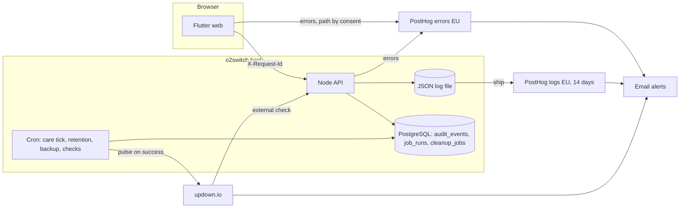

# Logging and monitoring — review and implementation plan

A first review of what Agatha Track logs and monitors today, and a phased plan to close the gaps.
Current behaviour stays documented in [observability.md](./observability.md); this file is the proposal.
As each step ships, its content moves into `observability.md` (or the runbook it names) and the step is
ticked here. When every step is done, delete this file.

**How to resume:** find the first step not marked ✅ in the [status board](#status-board) and tell the
agent: *"Let's do step N of `docs/ops/observability-review-and-plan.md`."*

Figures below were measured on `main` at `2a5f3ac` (2026-11-10), runtime code only (tests excluded), and count
**only code that survives the frozen-domains removal** (execute-plan `frozen-domains-removal-3f9c`,
[#2192](https://github.com/KanopeeKa/AgathaCheck/issues/2192)): the Shelter and Fostering routes, modules and
Flutter features it deletes are left out. They are a
baseline for this review and are not kept up to date: once a step lands, its lint rule and tests are the
source of truth, not a recount.

## Summary

More exists than "very little", but almost none of it can be seen or acted on.

- **In place:** a Pino JSON logger, a request ID and access log line on every API call, an `audit_events`
  table with tiered retention, consent-gated PostHog analytics, a durable `cleanup_jobs` queue, a post-deploy
  smoke, a nightly UAT in-host smoke, and weekly CodeQL, ZAP, k6 and `npm audit` runs.
- **The main gap is that nobody is told when something breaks.** Logs go to the cPanel/Passenger error log on
  the host and nowhere else. There is no log search, no error grouping, no uptime check, no alert and no
  on-call route. Every "alert" in the existing docs is a log line that someone would have to go and read.
- **The most serious code finding:** 82 `catch` blocks across 26 route files answer `500` and log nothing.
  The access log records that a 500 happened, but the error and stack trace are discarded. These failures
  cannot be diagnosed today.
- **The browser app reports nothing.** Flutter has no global error handler; 90 of 185 `catch` blocks are
  silent. A crash in a user's browser is invisible.

## Constraints that shape the plan

| Constraint | Effect |
|------------|--------|
| o2switch shared cPanel, Passenger, local PostgreSQL | No agents, sidecars or collectors on the host. No host CPU, memory or disk metrics beyond what cPanel shows. Everything must be in-process, cron, or an outside service called over HTTPS. |
| One Node process serves the API and the Flutter web build | Process-level signals (event-loop lag, memory, pool use) stand in for infrastructure metrics. |
| Health data, GDPR, EU hosting | Any new vendor is a new processor: EU region, DPA, and an entry in `regulatory/INTERNAL_GDPR.md` and the privacy notice. Logs must never carry health content, tokens or contact details. |
| Analytics is consent-based | PostHog cannot be the only source for errors or operational health: it only sees consenting users. |
| Pre-launch, production has no users | Thresholds can be set loosely and tuned on UAT first. Schema and log-format changes are cheap now and costly later. |
| CI minutes and a small team | Few vendors, few dashboards. Prefer email alerts over a console someone must watch. |

## Review by area

Rating: 🔴 missing · 🟠 partial, not usable in an incident · 🟡 works, with gaps · 🟢 adequate.

| # | Area | Now | What exists | Main gaps |
|---|------|-----|-------------|-----------|
| 1 | Infrastructure | 🔴 | `/health` and `/backend/health` return a fixed `OK`; startup checks the PG date parser | Health check never touches the database. No uptime monitor (open debt row). No process metrics. No `pool.on('error')` handler, so a dropped idle DB connection can crash the process. No `unhandledRejection` / `uncaughtException` handler. |
| 2 | Application logging | 🟠 | Pino; access log with `requestId`, method, path, status, duration (`server/middleware/requestContext.js`) | Only 24 logger calls in runtime code, against 20 `console.*` calls. No user ID, route template or release in the access line. No redaction config. Client-supplied `X-Request-Id` is trusted unchecked. Startup and shutdown use `console`. Logs stay on the host: no search, no stated rotation (the GDPR register promises 30 days). |
| 3 | Error monitoring | 🔴 | Central error middleware logs errors that reach it (`server/lib/http/errorMiddleware.js`) | 82 silent `500` handlers in 26 route files bypass it. No grouping, no release tagging, no notification. Nothing from the client. |
| 4 | Performance (APM) | 🟠 | `durationMs` per request; weekly k6 smoke against localhost in CI | Path contains IDs, so latency cannot be grouped by endpoint. No slow-query logging, no `statement_timeout`, no pool wait time. k6 never runs against a deployed host. |
| 5 | Frontend (RUM) | 🔴 | PostHog screen views for consenting users | No `FlutterError.onError`, `PlatformDispatcher.onError` or guarded zone. No load time, no API failure rate as the user sees it. The `request_id` the API returns in error bodies is not shown to the user or support. |
| 6 | Security monitoring | 🟠 | Auth rate limits; `auth.login_failed` audited; a written taxonomy with thresholds ([security-event-taxonomy.md](../engineering/pet-care-hardening/security-event-taxonomy.md)) | The taxonomy's alert rules are not implemented anywhere. 57 `403` responses and all `429` responses leave no security event. Share-link and health-file reads are not recorded. E2E bypass use is a `console.warn`. |
| 7 | Audit logging | 🟡 | `audit_events` with hot/warm/cold tiers; 34 call sites, about 40 actions | Only 11 of 121 route files write audit events. None in sharing (invites, role change, access removal), households, people, care context or health issues. Action names are inconsistent (`pet.updated` next to `update`, `create`, `add_reminder`). Writes are fire-and-forget, so an audit row can be lost without trace. Two pseudonym schemes: `pseudonymizeActor()` uses HMAC-SHA-256 (its only caller is in frozen code), the retention job uses `md5(id ‖ salt)`; `observability.md` documents the second. The retention cron is not installed (open debt row). |
| 8 | Business processes | 🟠 | `cleanup_jobs` with leases, retries and a `dead` state; care tick prints a JSON summary | No heartbeat on any scheduled job (care tick, audit retention, cleanup drain, suggestion generation). A cron that stops is silent. Dead jobs are only a log line. No record of emails sent or failed. |
| 9 | Integrations | 🔴 | PostHog person-delete has typed outcomes and retries | SMTP failures go to `console.error` in 4 places and are otherwise swallowed. No success/failure counts per provider. RevenueCat (`purchases_flutter`) and PostHog ingestion are unobserved. No outbound timeout or latency logging. |
| 10 | Product analytics | 🟠 | Consent gate, sensitive-screen exclusion, EU region, 12 custom events | All 12 events are care-done or weight flows. Nothing for signup, first pet, sharing, invites or paywall. No written event catalogue, no funnels or retention definitions. |
| 11 | Data integrity | 🟠 | One-off scripts: `reconcileHouseholds.js`, `reconcilePeopleVets.js`, `care/repair_occurrences.js --dry-run`; startup PG date check | Nothing scheduled. No invariant list. No check for orphaned files, access rows without a pet, or duplicate occurrences. |
| 12 | Operational governance | 🟠 | Deploy workflows with smoke and gate scripts; draft [backup plan](./prod-backup-restore-plan.md) (all steps open); weekly dependency and CI KPI jobs | No backups running. No certificate, domain or disk-quota check. No release marker in logs. No alert catalogue, severity routing or incident runbook. |

### Findings to fix regardless of tooling

1. **Silent 500s** — 82 handlers of the form `catch (err) { res.status(500).json({ error: publicError(err) }) }`.
2. **Process safety** — no pool error handler, no unhandled-rejection handler.
3. **Shallow health check** — reports `OK` while the database is down.
4. **Audit pseudonym mismatch** — code and retention job disagree; decide one scheme before real data exists.
5. **`logger.warn({ event })` in `server/lib/audit.js`** logs the whole audit event, including the `req` object,
   when required fields are missing. Log the action and resource type only.
6. **Failed login audit** records no usable target (no user, no hashed identifier), so repeated failures against
   one account cannot be counted.

## Target design

Three paths, one correlation ID.

Rules for every step:

1. **One event, one name.** Each log line carries a stable `event` (for example `http.request`,
   `email.failed`, `job.dead`, `authz.denied`). Alerts match on `event`, never on message text.
2. **One ID across the stack.** `requestId` is on the access line, error report, audit row and the error the
   user sees.
3. **Audit is not logging.** `audit_events` answers "who did what" and follows the retention tiers. Logs answer
   "what went wrong" and live 14 days. Product analytics answers "what do people use" and needs consent.
   Keep the three apart.
4. **Deny by default on content.** IDs, counts and field names only. No bodies, no health text, no emails, no
   tokens. Enforced by Pino `redact` and a test, not by care.
5. **Every scheduled job reports in.** Silence is the alert.
6. **Every alert has an owner, a severity and a runbook line** in one catalogue.

## Decisions

Steps 1–3 need no vendor and can start now.

### Taken (owner, 2026-11-10)

Vendor facts in this section are from the owner's check of each vendor's official documentation on that date.

| Capability | Choice | Notes |
|------------|--------|-------|
| Application errors | PostHog (EU Cloud) | Free allowance: 100,000 exceptions a month. Bugsink (Dutch, EU-hosted, Sentry SDKs, 15,000 events a month free) is the fallback if the UAT proof fails. |
| Technical logs | PostHog, selective structured collection | Free allowance: 10 GB ingested a month. **Default retention is 14 days**; longer is a paid storage option. |
| External uptime, TLS expiry | updown.io | French-operated. 100,000 introductory credits, then roughly €0.22 a month for one endpoint every five minutes; minimum top-up €5, no subscription. |
| Scheduled jobs | updown.io pulse checks | One service for both checks. healthchecks.io (Latvian, German hosting, 20 checks free, expects companies to upgrade eventually) is the fallback; it has no external website check. |
| Business audit trail | AgathaTrack database (`audit_events`) | Never PostHog. Own retention tiers, set in `observability.md`. |
| Product analytics | Existing PostHog setup | Consent-based, unchanged. |
| Alerts | Email from PostHog and updown.io | No paging, no extra alerting tool. |
| PostHog layout | Pay-as-you-go plan, separate operations project, spending limit of zero on every product | Keeps the monthly free allowances; a card is on file. Confirm the per-product limit exists when setting up; if it does not, set a billing alert at the lowest amount. |
| Browser errors | Both paths: full detail for users who accepted analytics, scrubbed for everyone else | See consequence 3. |
| Backups | None exist today. To be built soon, after the first steps of this plan, under [prod-backup-restore-plan.md](./prod-backup-restore-plan.md) | Must be running before launch. This plan only monitors backup age and the restore check. |
| Audit pseudonym | HMAC-SHA-256 everywhere, keyed by a dedicated `AUDIT_PSEUDONYM_SALT` | The retention job stops using `md5`; no fallback to `JWT_SECRET` or a default, and production refuses to start without the salt. Delivered in step 8. |
| Not adopted | Sentry, Grafana Cloud, Better Stack, GlitchTip, any self-hosted stack, distributed tracing | Revisit only if a chosen service fails its proof. |

Consequences the steps below must respect:

1. **Retention follows what is configured, not what was hoped.** Three stores, three policies: technical logs
   14 days in PostHog; error events at whatever PostHog applies to exceptions on our plan (confirm and record
   it); audit rows in our database under the hot/warm/cold tiers. `regulatory/INTERNAL_GDPR.md` says 30 days
   for application logs today and is corrected in the PR that turns log shipping on. Security detection
   (step 9) therefore reads `audit_events`, not logs, for anything older than 14 days.
2. **Operational telemetry and analytics are governed apart.** A separate project is tidy but is not a legal
   basis. Server-side errors and logs are always on, carry no cookies, no profile and no identifying fields
   beyond an opaque user ID, and do not depend on the analytics consent switch in either direction: opting out
   of analytics must not turn monitoring off, and monitoring must not collect analytics by another route.
3. **Browser errors take one of two paths, chosen by the analytics consent state, never both.**
   Users who accepted analytics: the PostHog SDK captures the error with full detail (user ID, screen name,
   recent navigation). Everyone else: the app posts a scrubbed report to our own API, which logs it and
   forwards it server-side. The scrubbed report holds the stack trace, release, route name, browser family and
   request ID only: no user ID, no cookies, no device identifier, no screen content, no IP stored. It is
   pseudonymous, not anonymous, because the request ID can be matched to server logs for 14 days. The scrubbed
   path runs on legitimate interest and needs a short written assessment and a privacy-notice line before it
   ships (step 7). Withdrawing consent moves a user to the scrubbed path at once.
4. **Two independent checks, neither implies the other.** An external check answers "can a real internet
   client reach the site and get a valid response". A pulse check answers "did the job finish successfully",
   so it pings only after success and reports failure explicitly. A job that starts and dies must alert.
5. **updown.io is not EU-only.** Its subprocessor list includes US providers and non-EU probe locations. This
   is acceptable because checks carry no personal data: probe URLs and pulse payloads must contain no user
   IDs, emails or tokens. Record it in the processing register all the same.

No decision is open. Every step can proceed in order.

### Proof on UAT before committing to the vendors

Run in step 4 (the first two) and step 7 (the third). A failure switches that capability to its fallback.

1. From outside the host, the updown.io check reaches the public endpoint and is not blocked or challenged by the o2switch WAF.
2. A scheduled job made to fail on purpose raises an email alert; the same job stopped entirely also raises one.
3. A Flutter web exception thrown on purpose appears in PostHog with a readable Dart stack trace.

## Status board

One PR per step. Each PR updates `observability.md` and ticks its row here.

| Step | Title | Areas | PR | Status |
|------|-------|-------|----|--------|
| 1 | Log every server error | 2, 3 | | ⬜ |
| 2 | Logger foundation: context, redaction, process safety | 1, 2 | | ⬜ |
| 3 | Real health checks and process metrics | 1, 4 | | ⬜ |
| 4 | External uptime and job pulse checks | 1, 8, 12 | | ⬜ |
| 5 | Log shipping and retention | 2 | | ⬜ |
| 6 | Error tracking: API | 3 | | ⬜ |
| 7a | Flutter web: global error handlers, source maps, request ID, consented path | 3, 5 | | ⬜ |
| 7b | Flutter web: scrubbed path for everyone else, with assessment and notice | 3, 5 | | ⬜ |
| 7c | Flutter web: silent-catch triage and timings | 3, 5 | | ⬜ |
| 8 | Audit coverage and consistency | 7 | | ⬜ |
| 9 | Security events and detection rules | 6 | | ⬜ |
| 10 | Job runs, email and integration outcomes | 8, 9 | | ⬜ |
| 11 | Endpoint and query performance | 4 | | ⬜ |
| 12 | Data integrity checks | 11 | | ⬜ |
| 13 | Product analytics catalogue and funnels | 10 | | ⬜ |
| 14 | Governance: alert catalogue, runbooks, release and expiry checks | 12 | | ⬜ |

Legend: ⬜ not started · 🟡 in progress · ✅ done (link PR)

Order and priority:

| When | Steps | Why |
|------|-------|-----|
| Now, no vendor | 1 → 2 → 3, then the email part of 10 | Makes failures diagnosable and removes the crash paths; failed reset and invite emails are launch-critical and need no vendor |
| Before meaningful UAT traffic | 4 → 5 → 6 | Someone is emailed when the site or a job fails |
| Alongside 5–6 | 7a, 7c | 7b must not merge before its assessment and privacy-notice line: a hard gate |
| Before launch | 8 → 9, rest of 10 | Sharing audit, brute-force detection, job records |
| After launch | 11–14 | Performance budgets, integrity checks, analytics catalogue, governance |

The backup plan starts once step 4 is in (it reuses the cron wrapper and pulse checks) and must finish before
launch.

Coordination with plans in flight (approved 2026-11-10):

| Plan | Touches | Effect on this plan |
|------|---------|---------------------|
| `frozen-domains-removal-3f9c` ([#2192](https://github.com/KanopeeKa/AgathaCheck/issues/2192)) | Deletes `server/routes/organizations/**`, `fosterPlacements.js`, `custodyTransfers.js`, 14 server modules, the frozen e-mails, two Flutter feature roots and 66 unreachable Flutter files; edits `server/bin/server.js` | No step edits a file that plan deletes. Start step 1 after its phase 2 merges, steps 2–3 likewise (`server.js`), the email part of step 10 after its phase 3, step 7 after its phases 1 and 4. If a step must start earlier, its lint rules exclude the frozen roots listed in `docs/engineering/frozen-domains/manifest.json`. |
| `ui-async-states-3f9b` ([#2191](https://github.com/KanopeeKa/AgathaCheck/issues/2191)) | The shared failed-load widgets and most screens that use them | Step 7a adds the support reference code to those widgets after that plan finishes. |
| `ui-invite-recipients-3f9a` ([#2190](https://github.com/KanopeeKa/AgathaCheck/issues/2190)) | Invite landing screens | None on the server. Step 8's invite audit rows cover the same flows; run its checks against the new return-to-invite path. |

Sub-steps (7a–7c) are separate PRs with one outcome each. The ordered steps suit `/light-plan` or
`/execute-plan` on an integration branch better than one-off prompts; the resume line above still works for a
single step.

## Steps

### Phase A — make failures visible in the code (no vendor)

**Step 1 — Log every server error**

Where the 82 handlers are: households 14, `notifications.js` 11, people 8, `healthIssues.js` 7, care
intelligence 7, `vets.js` 6, `sharing.js` 6, pets 5, `petTags.js` 4, care progression 4, timeline 4, health
issues folder 3, and one each in auth, the notifications folder and `healthFiles.js`. One PR.

- `sendServerError(req, res, err, publicMessage?)` in `server/lib/http/`: logs `{ event: 'http.error', err, requestId, route }` and answers `500` with the same body shape as today plus `request_id`. This also closes the open `publicError` debt row.
- **File already uses `asyncHandler`** (pets, auth): delete the `try/catch` and let the error middleware log and answer.
- **Everything else:** keep the handler shape and replace the body of the `catch` with `return sendServerError(...)`. No conversion to `asyncHandler` here; that is a separate refactor.
- ESLint rule for `server/routes/**`: no `res.status(500)` outside the helper, blocking from this PR.
- Response bodies must not change apart from the added `request_id`; the active route tests are the check.
- **Done when:** a forced failure in any route produces one error log line with a stack and the same `request_id` the client received; lint blocks a new silent handler.

**Step 2 — Logger foundation**

- `logger.js`: base fields `service`, `env`, `release` (git SHA written at deploy); Pino `redact` for `authorization`, `cookie`, `password`, `token`, `code`, `email`, `*.body`; error serialiser.
- `requestContext.js`: `req.log` child logger; add `userId` once auth has run, the Express route template (`/pets/:id`), response size; level by status (`warn` for 4xx security statuses, `error` for 5xx). Accept an inbound `X-Request-Id` only if it matches a UUID pattern.
- Replace the 20 runtime `console.*` calls; ESLint `no-console` for `server/{bin,lib,routes,services,config,middleware}`. `server/scripts/**` is exempt: command-line scripts keep `console` for output a person reads, and scheduled ones also print one JSON summary line (as the care tick does) that step 10 records.
- `createPool.js`: `pool.on('error')`. `start.js`: `unhandledRejection` and `uncaughtException` handlers that log `fatal` and exit cleanly; structured startup and shutdown lines.
- Fix finding 5. Write the event-name catalogue into `observability.md` and bring that file up to date (it was last revised 2026-08-21).
- **Done when:** a test proves a request carrying a password and bearer token logs neither; killing the DB connection logs an error and the process survives.

**Step 3 — Health checks and process metrics**

- Keep `/health` as liveness. Add `/health/ready`: `SELECT 1` with a short timeout, latest migration, release SHA, cleanup-runner state. No secrets, no counts of user data.
- Log `process.stats` every minute: event-loop lag, RSS and heap, pool total/idle/waiting.
- Point the post-deploy smoke and UAT in-host smoke at `/health/ready`.
- **Done when:** stopping PostgreSQL turns `/health/ready` to `503` within the timeout.

### Phase B — get the signals off the host and to a person

**Step 4 — External uptime and job pulse checks** (updown.io)

- External check on the public `/backend/health/ready` for UAT and production, with TLS-expiry alerts. If UAT sits behind Basic Auth, check a path the gate leaves open or supply the credential in the check, never in the URL.
- Wrapper script for cron jobs: ping the pulse URL only after the job exits `0`; on any other exit send the failure signal. Apply to the care tick, `audit-retention.js` and `run-cleanup-jobs.js`. Share the crontab mechanism with backup plan step 3 rather than building a second one.
- Email alerts to the owner. Add updown.io to the processing register. Closes the uptime and retention-cron debt rows.
- **Done when:** UAT proofs 1 and 2 pass, and stopping the UAT app raises an alert while the job pulse stays green (and the reverse).

**Step 5 — Log shipping and retention** (PostHog logs)

- Ship selectively: `warn` and above, plus the named events alerts depend on (`http.error`, `email.failed`, `job.*`, `authz.denied`, `process.stats`). The full access log stays in a rotated file on the host, outside the deploy folder, kept 14 days.
- Retention 14 days in both places; correct the 30-day line in `INTERNAL_GDPR.md` and the privacy notices in this PR.
- Saved searches: errors by route, by release, one request by ID. Usage alert well below the 10 GB allowance.
- **If PostHog logs fail on UAT** (ingestion from the host, search, or retention control): no replacement vendor. Keep the rotated host file as the only log store, read over SSH; errors still reach the error tracker in step 6, and alerts on errors, jobs, email and integrity are driven instead from the error tracker or from the scheduled database checks in steps 9, 10 and 12. **What is lost:** the rate alerts on 401/403/429 per IP, which exist only in logs. In that case step 9 writes those denials to a small `security_events` table instead, so the scheduled check can count them.
- **Done when:** a UAT request can be found by its `request_id` within a minute, nothing older than 14 days exists, and a test proves no redacted field leaves the host.

**Step 6 — Error tracking: API** (PostHog)

- Server-side capture in `start.js`, independent of any browser consent state, fed from `sendServerError`, the error middleware, process handlers and job failures. Tags: release, route, `requestId`. Scrub with the same deny-list as the logger; send no bodies.
- Release created by the deploy workflows. Email alert on a new error group and on a regression after deploy. Record the retention PostHog applies to exception events.
- **Done when:** a deliberate UAT error appears grouped, with the right release, and notifies.

**Step 7 — Error tracking and RUM: Flutter web** (PostHog; three PRs)

Capture paths are set in Decisions, consequence 3. No session replay, no screen content, sensitive screens
excluded as in `analytics_service.dart`.

**7a — handlers and the consented path**

- Global handlers in `main.dart` (`FlutterError.onError`, `PlatformDispatcher.instance.onError`, guarded zone) feeding one reporter that picks the path from the consent state. Until 7b lands, the reporter drops errors from users who have not accepted analytics. **Known gap:** between 7a and 7b, browser crashes for those users stay invisible; only their failed API calls are seen, server-side.
- Upload source maps in the web build.
- HTTP client: send a generated `X-Request-Id`, keep the returned `request_id`. Show a short reference code in the shared failed-load widgets so a user can quote it to support.
- **Done when:** UAT proof 3 passes for a consenting user and the error links to the API error by ID.

**7b — scrubbed path for everyone else** (hard gate: assessment and notice in the same PR)

- `POST /api/client-errors`: rate-limited, size-capped, schema-validated, unknown fields dropped; logs and forwards server-side.
- A test proves each error takes exactly one path and that the scrubbed payload carries none of the excluded fields.
- Written legitimate-interest assessment under `regulatory/`; privacy-notice line in every language; processing-register row.
- **Done when:** UAT proof 3 passes for a user who declined analytics, with a readable stack and no user identifier in the stored event.

**7c — silent catches and timings**

- Triage the 90 silent `catch` blocks: report, or comment why ignoring is correct. A lint rule for empty `catch` keeps the count from growing.
- Timings: app start to first usable screen, route change duration, API failure rate and latency by endpoint template.

### Phase C — security, audit and workflows (before launch)

**Step 8 — Audit coverage and consistency**

- One registry of actions (`domain.verb_past`), with a test that rejects unknown actions; rename the outliers.
- Cover the missing mutations, sharing first: invite create/accept/decline/revoke, role change, access removal, unfollow; then households, people, care context, health issues, vets.
- Record sensitive reads: health-file download, share-link open, data export (present).
- Write the audit row inside the transaction for account, permission, sharing and deletion actions; keep fire-and-forget for the rest, with an `audit.write_failed` event that alerts.
- One pseudonym scheme (Decisions): the retention job calls `pseudonymizeActor()` instead of `md5` in SQL; startup fails in production without `AUDIT_PSEUDONYM_SALT`; a test proves a row aged by the job carries the helper's value. Correct the `md5` line in `observability.md`. Add a target hash to `auth.login_failed`. A coverage test lists mutating routes with no audit call against an allow-list.
- Closes the "extend `audit_events`" debt row.
- **Done when:** the coverage test passes with an empty unexplained list.

**Step 9 — Security events and detection rules**

- Emit `authz.denied` (403), `auth.rejected` (401) and `ratelimit.hit` (429, via the limiter `handler`) with user, IP, route template and reason. Audit E2E-bypass use.
- Each detection rule names the one store it reads. **`audit_events`** (scheduled check `server/scripts/ops/security-check.js`): anything about an account or a resource, and anything that may need looking at after 14 days. **Log store** (PostHog alert, window of 24 hours or less): rate signals only, namely 401/403/429 spikes per IP and 5xx per route. Denials that are audited as well as logged (`outcome: 'denied'`), because they may matter after 14 days: any 403 on sharing, access-role, household-membership, data-export, account-deletion and health-file routes. All other 401/403/429 are logged only. Rules on `audit_events`: failed-login bursts per account and per IP, reset storms, export volume, permission grants, mass deletion. Output is an email alert and a failed pulse check.
- Move the taxonomy from `docs/engineering/pet-care-hardening/` to `docs/ops/` as the live rule list.
- **Done when:** scripted brute force on UAT raises a P1 within the documented window.

**Step 10 — Job runs, email and integration outcomes**

- `job_runs` table (job, started, finished, outcome, counts, redacted error) written by every scheduled script and the cleanup runner; `job.dead` and `job.failed` events alert.
- One mail path: every send goes through `sendTransactionalEmail`, which logs `email.sent` / `email.failed` with template name and a recipient hash. Alert on failure rate and on any failed password-reset or invite email.
- Wrapper for outbound calls (PostHog, later calendar or payment webhooks): timeout, duration, outcome.
- Reminder workflow: record scans run, items due, notifications produced, so "no reminders today" can be told apart from "nothing was due".
- **Done when:** breaking SMTP on UAT raises an alert and the failed sends are countable.

### Phase D — depth

**Step 11 — Endpoint and query performance**

- Latency percentiles by route template from the access log. Query wrapper logging `db.slow_query` over a threshold with the statement name, never parameters. `statement_timeout` on the pool. Pool wait time.
- Budget per endpoint class written in `observability.md`; alert on sustained breach. Run the k6 smoke against UAT after deploy, not only localhost.

**Step 12 — Data integrity checks**

- `server/scripts/ops/integrity-check.js`, read-only, nightly, with a pulse check. Start with: access rows pointing at missing pets or users; pets with no owner; duplicate or out-of-order care occurrences (reuse `repair_occurrences --dry-run`); household and people drift (reuse the reconcile scripts in report mode); files on disk without a row and rows without a file; `cleanup_jobs` stuck in `running`; audit rows past their tier.
- Each invariant has an ID, a query and an owner in `docs/ops/`. Violations alert as P2 with counts only.

**Step 13 — Product analytics catalogue and funnels**

- Event catalogue (name, properties, owner, sensitivity) in the repo; a test rejects events not in it.
- Add the missing lifecycle events: signup completed, first pet, first care item, first completion, invite sent and accepted, paywall viewed and converted.
- Define activation, the weekly retention cohort and feature adoption in PostHog. Server-side aggregate counts (no user IDs) for totals that must not depend on consent.

**Step 14 — Governance**

- Alert catalogue: every alert with severity, owner, threshold, runbook link. Incident runbook and a short post-incident template.
- Release marker in logs and error tracker; deploy failure and rollback raise an alert, not only a red workflow.
- Scheduled checks for host disk quota, database size, upload folder size, backup age (with the backup plan), certificate and domain expiry, vendor quota and cost.
- Quarterly review: prune noisy alerts, test one alert of each severity, re-read the redaction list.

## Out of scope for this plan

- Backups and restore: owned by [prod-backup-restore-plan.md](./prod-backup-restore-plan.md); this plan only monitors them.
- Distributed tracing: one process and one database do not justify it. Request ID correlation is enough.
- A support UI for audit lookup, and PostHog replay or group analytics: tracked in `docs/debt/debt.md`.

## Related documents

- [observability.md](./observability.md) — current behaviour
- [security-event-taxonomy.md](../engineering/pet-care-hardening/security-event-taxonomy.md) — severity tiers and thresholds
- [cleanup-jobs.md](./cleanup-jobs.md) · [care-tick.md](./care-tick.md) — job runbooks
- `regulatory/INTERNAL_GDPR.md` · `regulatory/DATA_MAP.md` — processing register
